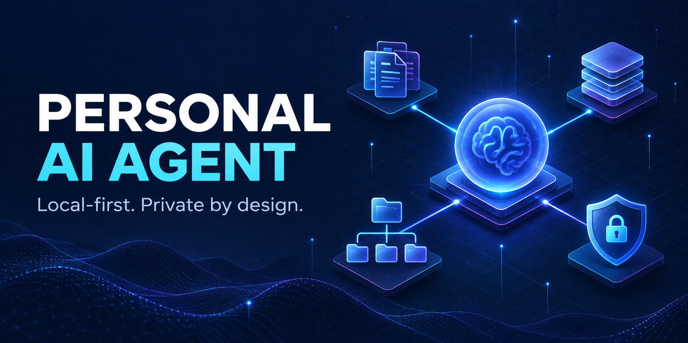
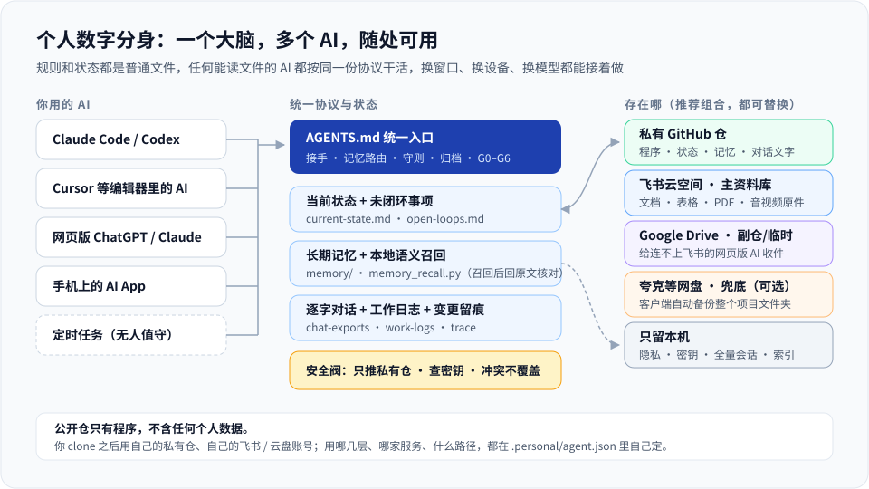
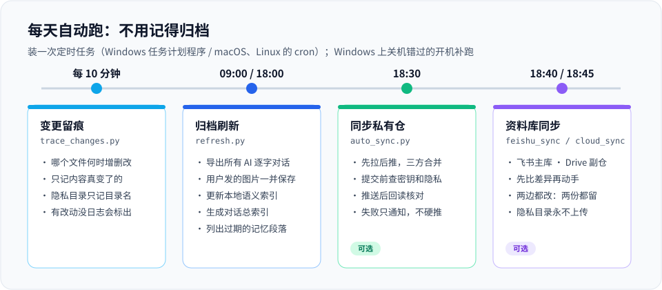
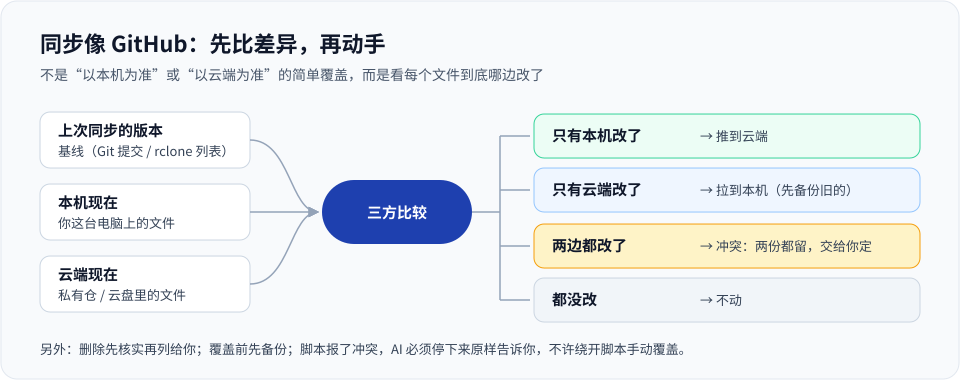

# Personal AI Agent

[简体中文](README.md) · [Setup (zh)](docs/setup.md) · [Architecture](docs/architecture.md) · [FAQ](docs/faq.md)



**Build your own "digital twin" workspace: every AI you use shares one set of rules, memory, and work records, so you can switch windows, machines, or models and keep going. Conversations are archived automatically every day, and your data lives only in your own private repository, cloud drive, and computer.**

Most AI frustration is not about model quality. It is about context trapped in a chat window: a new session forgets where you stopped, Claude, ChatGPT, and Codex each keep their own version of the truth, paths differ between machines, important decisions cannot be found verbatim, and personal material leaks into places it should not go. This project moves the working context out of the chat window into files you control, plus a protocol and a few small tools that keep it up to date automatically.

## Who it's for

- People who use several AIs at once (Claude Code, Codex, Cursor, web ChatGPT/Claude, Doubao…) and want them to share one memory.
- People who switch between machines and want to pick up exactly where they stopped.
- People running long projects with AI — coding, consulting, sales follow-up, study, research.
- People who care about data ownership: nothing is locked inside one AI product.
- Teams, clients, and colleagues who each want their own copy with their own accounts and habits.

Not for you if you just want a ready-made chatbot (there is no model and no UI here).

## What you get

- **One brain, many AIs** — Claude Code, Codex, Cursor, and web ChatGPT / Claude all read the same `AGENTS.md` and follow the same start, work, and wrap-up rules.
- **Pick up instantly in a new window** — one global current-state file and one open-loops file; agents read them first and update them last.
- **Find what was said** — local AI sessions are exported verbatim to Markdown (attached images included); an optional local semantic index finds candidates, and the agent verifies against the source text.
- **Daily automatic archiving** — install the schedule once: archive refresh at 09:00 / 18:00, change trace every 10 minutes.
- **Store anywhere, use anywhere** — the recommended stack is a **private** GitHub repository (program and state) + your own Feishu/Lark Drive (main file library) + Google Drive (secondary store and inbox for web AIs) + an optional backup client such as Quark. Every layer is replaceable and uses your own accounts. Another machine runs `git pull`; a web AI connects to the private repo.
- **Git-style sync, not blind overwrite** — three-way comparison against the last synced version; if both sides changed, both copies are kept and you decide.
- **Leak guards** — pushes are only allowed to the private remote you registered; every commit is scanned for secrets, national ID numbers, private folders, and oversized files.
- **Working discipline** — seven working rules, a G0–G6 change workflow, and task cards; agents must report how they verified and what they did not verify.
- **First-time setup asks you everything** — every person stores things differently, so the first run walks you through each choice one at a time (private repo, archive sources, main file library, inbox, schedule, skill targets, backup). Nothing is decided for you.
- **Skills as full copies, not pointers** — keep the originals in `skill/`, put a full copy in each AI's skills directory, so no machine being off breaks a skill.
- **No lock-in** — Markdown, JSON, and a few Python scripts. Any AI that reads local files can use it; you choose the repository and the cloud.







> The diagrams and most project documents are in Chinese, which is the primary audience. The tools print Chinese messages; the code and file layout are language-neutral.

## Quick start

Requires Python 3.9+, Git, and an AI tool that can read a local directory.

```bash
git clone https://github.com/davidme6/personal-ai-agent.git my-agent
cd my-agent
python tools/init_workspace.py
python tools/check_workspace.py
python tools/setup_wizard.py     # first-time setup: choose how you want to store things, one question at a time
```

Then tell your AI: *"Read `AGENTS.md`, then `.personal/current-state.md`, report the current state, then continue."*

**Private-repository mode (recommended).** Create an empty **private** repository, then:

```bash
python tools/init_workspace.py --private-repo https://github.com/<you>/my-agent-private.git
git remote rename origin upstream
git remote add origin https://github.com/<you>/my-agent-private.git
python tools/install_git_hooks.py
git add .personal && git commit -m "Initialize my workspace"
git push -u origin main
```

**Daily automation.**

```bash
python tools/install_schedule.py --dry-run
python tools/install_schedule.py      # Windows Task Scheduler, or cron on macOS / Linux
```

**Optional file library for originals** (`.personal/files/`). Feishu/Lark Drive via the official CLI logged in with your own account (`feishu` section in `.personal/agent.json`), or any rclone remote such as Google Drive (rclone 1.66+, `cloud.remote`; by default it only syncs the inbox `.personal/inbox/` — set `cloud.local_path` to `.personal/files` to use it as the main library):

```bash
python tools/feishu_sync.py whoami && python tools/feishu_sync.py plan
python tools/feishu_sync.py sync --approve <plan-id>

python tools/cloud_sync.py init          # first time: preview only
python tools/cloud_sync.py init --yes    # then establish the baseline
python tools/cloud_sync.py plan
python tools/cloud_sync.py run
```

| Role | Recommended | Replaceable with |
|---|---|---|
| Program + state | Private GitHub repository | GitLab, Gitee, self-hosted Git |
| Main file library | Feishu/Lark Drive | Google Drive, OneDrive, WebDAV, any rclone remote |
| Secondary / inbox | Google Drive | Any rclone remote |
| Backup (optional) | Quark or another backup client | OneDrive, external disk |

## Privacy: what is uploaded and what never is

| Content | Private Git repo | Cloud (Feishu / drive) |
|---|---|---|
| State, memory, chat text, logs | uploaded (your **private** repo) | not uploaded |
| Original files (documents, spreadsheets, PDFs, audio, video, archives — any format) | **never in Git** | uploaded to your own drive, **no format limit by default**; you choose what to exclude |
| `.personal/private/` | **never uploaded** | **never uploaded** (fixed rule) |
| Secrets, tokens, `.env`, `*.pem` | **never uploaded** (guard blocks) | **not uploaded by default**; you may explicitly opt in |
| `.device/`, `.local/` | never | never |

Every choice is asked **during first-time setup**; none is decided for you. No account is built in.

## Framework vs. your data

| Public framework (this repository) | Your data (only in your own spaces) |
|---|---|
| `AGENTS.md`, `config/`, `workflows/`, `templates/`, `tools/`, `tests/`, `docs/` | `.personal/` — state, memory, logs, verbatim chats → your private repo |
| `config/agent.example.json` | `.personal/files/` — originals → your cloud drive |
| | `.personal/private/`, `.device/`, `.local/` — this machine only |

In the public template `.personal/` is entirely ignored by Git. Only after you enable private-repository mode is its text state committed, and the hooks only allow pushing to the private remote you registered.

## Tools

| Tool | Purpose |
|---|---|
| `init_workspace.py`, `check_workspace.py` | Create and validate the workspace; `--private-repo` enables private-repository mode |
| `setup_wizard.py` | First-time setup: asks you one question at a time (terminal, or an AI via `--questions` / `--answer`) — the recommended stack is not mandatory |
| `skill_sync.py` | Sync `skill/<name>/` as **full copies** (not pointers) into each AI's skills directory; diff first, never overwrite conflicts, back up before replacing |
| `chat_archive.py` | Export local Claude Code / Codex sessions verbatim; build the index |
| `refresh.py` | One command: export, semantic index, chat index, stale-memory report |
| `memory_index.py`, `memory_recall.py` | Optional local semantic index and recall (`fastembed`) |
| `trace_changes.py` | File change ledger; flags days with changes but no work log |
| `sync.py`, `auto_sync.py` | Pull / push with three-way merge, no force-push, read-back verification |
| `feishu_sync.py` | Feishu/Lark Drive sync via the official CLI: three-way, keep both on conflict, never deletes in the cloud |
| `cloud_sync.py` | rclone bisync wrapper: keep both on conflict, stop on mass delete |
| `upload_check.py`, `workflow_gate.py` | Pre-commit leak and boundary checks; optional task-card gate |
| `install_git_hooks.py`, `install_schedule.py` | Install hooks and scheduled tasks |

## License

[GNU Affero General Public License v3.0 only](LICENSE) © 2026 davidme6. See [COMMERCIAL-LICENSE.md](COMMERCIAL-LICENSE.md) for proprietary-integration inquiries and [SUPPORT.md](SUPPORT.md) for how to help.
