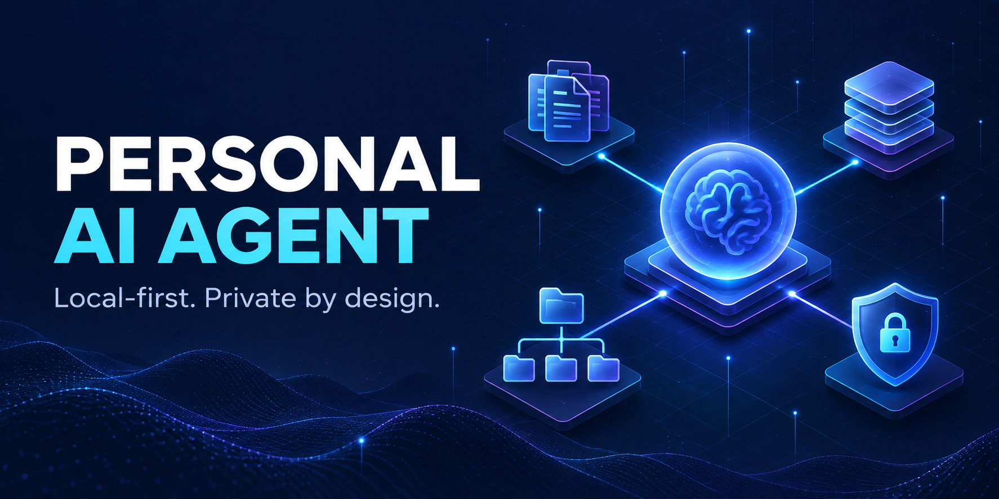
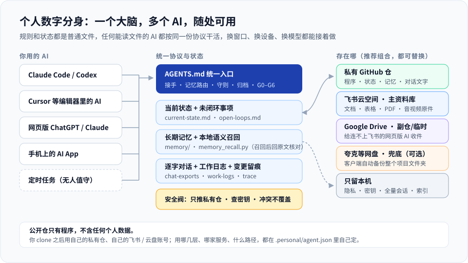
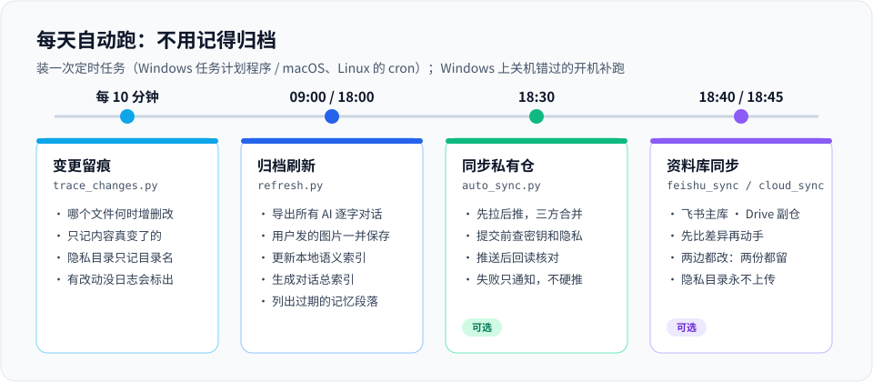
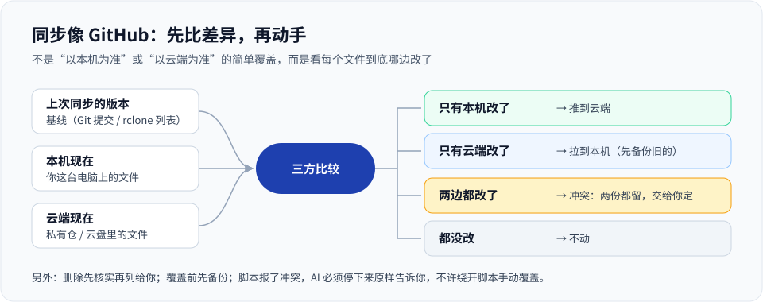

# Personal AI Agent｜个人数字分身

[English](README.en.md) · [首次设置](docs/setup.md) · [架构](docs/architecture.md) · [随时随地用](docs/anywhere-access.md) · [定时自动化](docs/automation.md) · [同步与差异](docs/sync-and-diff.md) · [常见问题](docs/faq.md)



**给自己搭一个“数字分身”：所有 AI 共用同一份规则、记忆和工作记录，换窗口、换电脑、换模型都能接着干；对话每天自动归档，数据只存在你自己的私有仓、云盘和电脑里。**

用 AI 干活久了，会碰到这些事：新开一个窗口，AI 忘了上次做到哪；Claude、ChatGPT、Codex 各记各的，口径对不上；台式机和笔记本的路径不一样；聊过的重要决定找不回原话；资料和代码混在一起，一不小心就传到了公开的地方。

这个项目把“AI 的工作上下文”从聊天窗口里拿出来，变成你自己掌控的文件，再配上一套规则和几个小工具，让这件事每天自动发生。

## 适合谁用

- **同时用好几个 AI 的人**：Claude Code、Codex、Cursor、网页版 ChatGPT / Claude、豆包……希望它们共用同一份记忆，而不是各记各的。
- **在多台电脑、手机之间切换干活的人**：公司电脑、家里电脑、云端环境，想打开就能接着做。
- **用 AI 做长期项目的人**：写代码、做咨询方案、销售跟进、学习备考、研究写作，都有“上次做到哪、为什么这么定”要记住。
- **在意数据归属的人**：不想把工作记忆交给某一家 AI 产品；数据只放你自己的私有仓、云盘和电脑里，换模型、换产品都不丢。
- **客户、同事、团队**：可以各自 fork 一份，用自己的账号和习惯搭一个自己的数字分身。

**不适合：** 只想要一个开箱即用的聊天机器人（这里没有模型，也没有界面）；完全不想碰命令行和文件夹（首次设置可以让 AI 带着你做，但日常维护仍需要一点文件操作）。

## 它是怎么用的：典型的一天

1. **早上**：打开任意 AI，对它说“先读 AGENTS.md，接着干”。它读当前状态和未闭环事项，告诉你昨天停在哪、今天该做什么。
2. **白天**：在 Claude Code、Codex、网页版 AI 之间随便切换，它们读的是同一份状态；做的决定、改的文件都写回去。
3. **随时**：想不起“上个月那个方案是怎么定的”，让 AI 先做语义召回，再打开原始对话核对后回答。
4. **自动**：每天 09:00 / 18:00，定时任务把所有 AI 的对话逐字导出归档；每 10 分钟记一次文件变更留痕。
5. **晚上**：说一句“归档本地云端”，AI 先拉后推，把状态同步到你的私有仓和云盘；换另一台电脑 `git pull` 就能接着做。

## 用了以后是什么效果

- **一个大脑，多个 AI**：Claude Code、Codex、Cursor、网页版 ChatGPT / Claude 都先读同一份 `AGENTS.md`，按同一套规矩接手、干活、收尾。
- **新窗口秒接上**：全局只有一份“当前状态”和一份“未闭环事项”，AI 开工先读，结束前更新。
- **说过的话找得回**：本机所有 AI 的对话逐字导出成 Markdown（连你发的图片一起），本地语义检索帮你找到“上个月定的那件事”，再回原文核对。
- **每天自动归档**：装一次定时任务，每天 09:00 / 18:00 自动导出对话、更新索引；每 10 分钟记一次文件变更留痕。
- **随时随地存，随时随地用**：推荐组合是 GitHub 私有仓（程序和状态）+ 飞书云空间（主资料库）+ Google Drive（副仓、给网页版 AI 的临时收件箱）+ 夸克等网盘（兜底备份）。每一层都能换、都用你自己的账号；另一台电脑 `git pull`、网页版 AI 连上私有仓，就能接着用。
- **同步像 GitHub 一样先比差异**：不搞“以本机为准”的一刀切覆盖；两边都改过的算冲突，两份都留，交给你定。
- **防泄露安全阀**：只许推到你登记的私有仓；每次提交前自动查密钥、身份证号、隐私目录和超大文件。
- **干活有规矩**：七条做事守则 + G0–G6 改造流程 + 任务卡，AI 做完要说清楚怎么验证的、哪些没验证。
- **不绑定任何模型和账号**：核心是 Markdown、JSON 和几支 Python 脚本，任何能读本地文件的 AI 都能用；用哪个仓库、哪个云盘你自己定。

## 功能全景

| 板块 | 能做什么 | 在哪 |
|---|---|---|
| 统一协议 | 接手协议、记忆路由、七条做事守则、三个归档指令、会话什么时候换 | [AGENTS.md](AGENTS.md) |
| 多模式 | 学习 / 顾问 / 销售 / 系统 / 自定义模式，共用一个底座，按任务切换 | [modes/](modes/README.md) |
| 记忆系统 | 五层记忆（原始数据 → 事件 → 状态 → 路由 → 工作上下文）、元数据与过期、未闭环事项、交接 | [记忆系统](docs/memory-system.md) |
| 检索 | 本地语义召回 + 关键词 / 日期检索，召回后必须回原文核对 | `memory_recall.py`、`search_memory.py` |
| 知识库 | 三类知识源的可信度与顺序、验证铁律、待验证 / 已验证分层、资料归组 | [知识源与验证](docs/knowledge-sources.md) |
| 对话归档 | Claude Code / Codex / WorkBuddy 会话逐字导出（带图片），豆包桌面客户端（仅 Windows，需在 `archive.sources` 里加 `doubao`），网页版 AI 逐轮归档，总索引，完整性检查 | `chat_archive.py`、`doubao_export.py`、`archive_check.py`、[网页版归档](docs/web-ai-archive.md) |
| 每日自动化 | 定时归档、变更留痕、自动同步私有仓、资料库同步（Windows 上关机错过的开机补跑） | `install_schedule.py`、[定时自动化](docs/automation.md) |
| 随时随地 | 私有仓模式；飞书主资料库、Google Drive 副仓、夸克兜底，全部可替换 | [随时随地用](docs/anywhere-access.md) |
| 同步与安全 | 三方比较、冲突两份都留、只推私有仓、提交前查密钥、存云端前先确认去处 | `sync.py`、`feishu_sync.py`、`cloud_sync.py`、`upload_check.py`、[写入护栏](skill/cloud-write-guard/SKILL.md) |
| 工作纪律 | G0–G6 改造流程、任务卡、工作日志、日终复盘、多 AI 研讨互审 | [workflows/](workflows/)、`roundtable.py` |
| 多模型 | 一条命令调用 DeepSeek、通义千问、Kimi、智谱、OpenAI、本地模型做交叉验证 | `call_llm.py`、[多模型接入](docs/multi-model.md) |
| 音视频 | 本地转写成文字和字幕（不花 API 费），自动生成转写清单 | `transcribe.py`、`media_inventory.py` |
| Skill | 项目里存一份备份，各家 AI 的技能目录里放完整副本（不放指针，哪台电脑关机都能用），同步先比差异、冲突不覆盖 | `skill_sync.py`、[skill/](skill/README.md)、[Skill 做法](docs/skills.md) |
| 首次设置 | 第一次使用时逐项问你怎么选：私有仓、归档来源、主资料库、副仓、定时时间、Skill 同步到哪几家、兜底备份。推荐组合不是绑定 | `setup_wizard.py`、[首次设置](docs/setup.md) |

## 架构



## 每天自动跑



## 同步像 GitHub：先比差异，再动手



## 五分钟上手

需要 Python 3.9+、Git，以及一个能读本地目录的 AI 工具（Claude Code、Codex、Cursor 等）。macOS / Linux 上如果只有 `python3`，把下面命令里的 `python` 换成 `python3`。

**1. 拿到框架，初始化本机工作区**

```bash
git clone https://github.com/davidme6/personal-ai-agent.git my-agent
cd my-agent
python tools/init_workspace.py
python tools/check_workspace.py
```

初始化只创建缺少的文件，不会覆盖你已经写过的东西。

**首次设置：逐项选择你自己的存储方式和习惯。** 推荐组合只是推荐，每一项都可以换或者不用，所以第一次要挨个选：

```bash
python tools/setup_wizard.py        # 终端里一项一项问你
```

用 AI 的话，对它说：

> 先读 `AGENTS.md`，按“首次设置”一项一项问我怎么选，不要替我选。

AI 会调用 `python tools/setup_wizard.py --questions` 拿到问题清单，逐项向你解释选项和代价，你选完它再写入设置。设置完成后，让 AI 打开这个目录，对它说：

> 先读 `AGENTS.md`，再读 `.personal/current-state.md`，告诉我当前状态，然后开始干活。

**2.（推荐）开启私有仓模式：随时随地存、随时随地用**

先在 GitHub 新建一个 **Private** 空仓库（比如 `my-agent-private`），然后：

```bash
python tools/init_workspace.py --private-repo https://github.com/<你的用户名>/my-agent-private.git
git remote rename origin upstream        # 模板地址留着，以后拉更新用
git remote add origin https://github.com/<你的用户名>/my-agent-private.git
python tools/install_git_hooks.py        # 装安全阀：只许推私有仓、提交前查密钥
git add .personal && git commit -m "初始化我的数字分身"
git push -u origin main
```

之后在别的电脑上 `git clone` 你的私有仓，跑一次 `python tools/init_workspace.py`（只补本机文件），就能接着做。网页版 ChatGPT / Claude 连上这个私有仓，也能读到你的规则和状态。详见 [随时随地用](docs/anywhere-access.md)。

**3. 装定时任务：每天自动归档**

```bash
python tools/install_schedule.py --dry-run   # 先看会装哪些任务
python tools/install_schedule.py             # Windows 用任务计划程序，macOS / Linux 用 cron
```

时间点在 `.personal/agent.json` 的 `schedule` 里改。设了私有仓才会装“同步私有仓”，开了飞书自动同步、设了云盘才会装对应的资料库同步。详见 [定时自动化](docs/automation.md)。

**4.（可选）资料库：原件放云端**

文档、表格、PDF、音视频放 `.personal/files/`。推荐组合和可替换项见下一节，按你用的那家选一种：

```bash
# 飞书云空间（推荐主资料库）：先装好飞书官方 CLI 并用你自己的账号登录，
# 在 .personal/agent.json 的 feishu 段填 enabled、profile、folder_token
python tools/feishu_sync.py whoami                 # 先确认 CLI 用的是不是你要存的那个账号
python tools/feishu_sync.py plan                   # 只出计划，不动手
python tools/feishu_sync.py sync --approve <计划编号>

# Google Drive / OneDrive / WebDAV 等（副仓）：用 rclone，填 cloud.remote；默认只同步收件箱 .personal/inbox/，
# 不用飞书、想让它当主资料库时，把 cloud.local_path 改成 .personal/files
python tools/cloud_sync.py init                    # 第一次：先预览，不改任何东西
python tools/cloud_sync.py init --yes              # 确认后建立基线
python tools/cloud_sync.py plan                    # 之后每次先看会发生什么
python tools/cloud_sync.py run
```

## 推荐的存储组合（都可替换）

| 角色 | 推荐 | 可替换为 | 管什么 |
|---|---|---|---|
| 程序 + 状态 | **GitHub 私有仓** | GitLab、Gitee、自建 Git | 规则、工具、当前状态、记忆、任务卡、工作日志、逐字对话 |
| 主资料库 | **飞书云空间** | Google Drive、OneDrive、坚果云等 | 文档、表格、PDF、音视频原件（存完整版） |
| 副仓 / 临时仓 | **Google Drive** | 任意 rclone 云盘 | 网页版 ChatGPT 等连不上飞书的平台先存这里，本机归档时取回并入主库 |
| 兜底备份（可选） | **夸克网盘** 客户端自动备份 | 百度网盘、OneDrive、移动硬盘 | 整个项目文件夹的另一份副本 |
| 只留本机 | — | — | 隐私文件、密钥、索引、全量会话记录 |

用哪几层、用哪家、用哪个账号，都在 `.personal/agent.json` 里自己定。框架不内置任何账号；第一次往某个账号写入前，工具会把“当前登录的是谁、存到哪个文件夹”原样列出来让你确认。

## 平时怎么用：对 AI 说这几句

| 你说 | AI 做什么 |
|---|---|
| “先读 AGENTS.md，接着干” | 读当前状态、未闭环事项和相关项目，汇报后开工 |
| “归档” | 跑 `refresh.py` 导出所有 AI 的逐字对话、更新索引，补工作日志、任务卡、交接和未闭环事项；只动本机 |
| “归档本地云端” | 归档之后先拉后推，同步到你的私有仓（和云盘），本机云端都是最新 |
| “结束 / 今天到这” | 按“归档”收尾，并告诉你还有哪些没上传 |
| “上个月我们定的 XX 是什么” | 先语义召回，再打开原文核对后回答 |

## 隐私：哪些会上传，哪些永远不上传

| 内容 | Git 私有仓 | 云端（飞书 / 云盘） | 说明 |
|---|---|---|---|
| 当前状态、记忆、对话文字、日志 | 上传（你自己的**私有**仓） | 不传 | 先过安全阀 |
| 原件资料（文档、表格、PDF、音频、视频、压缩包……任何格式） | **不进 Git** | 上传到你自己的云盘，**默认不限制文件格式** | 想排除的类型、文件夹，首次设置时自己选 |
| `.personal/private/` 个人隐私文件夹 | **永远不上传** | **永远不上传** | 固定规则，不可关 |
| 密钥、令牌、`.env`、`*.pem` 等 | **永远不上传**（安全阀拦截） | **默认不上传**，你可以明确选择上传到自己的云盘 | 首次设置会专门问你 |
| `.device/`、`.local/`（凭据、索引、全量会话备份） | 永远不上传 | 永远不上传 | 只留本机 |

所有这些选择都在**第一次使用时逐项问你**，不替你默认。框架里没有任何内置账号，所有云端都是你自己的。

## 公开框架和你的数据

| 公开、可版本管理（本仓库） | 你的数据（只在你自己的空间） |
|---|---|
| `AGENTS.md`、`config/`、`workflows/`、`templates/` | `.personal/current-state.md`、`memory/`、`handoff/` |
| `tools/`、`tests/`、`docs/` | `.personal/logs/`（逐字对话、工作日志、任务卡、留痕） |
| 示例配置 `config/agent.example.json` | `.personal/agent.json`（你的仓库、云盘、时间点） |
| | `.personal/files/` 原件 → 你的飞书 / 云盘 |
| | `.personal/private/`、`.device/`、`.local/` → 只留本机 |

公开模板里 `.personal/` 整个被 Git 忽略；只有你开启私有仓模式后，`.personal/` 里的文字状态才会提交，而且安全阀只许推到你登记的私有仓。原件、隐私目录、密钥、索引数据库任何时候都不进 Git。

## 目录

```text
my-agent/
├── AGENTS.md                 # 所有 AI 的统一入口和规则
├── config/                   # 示例配置、隐私与存储说明
├── workflows/                # 开工、收尾、日终复盘、G0–G6 改造流程
├── modes/                    # 学习 / 顾问 / 销售 / 系统 / 自定义模式
├── skill/                    # Skill 原版（备份和统一修改处），skill_sync.py 同步完整副本到各家 AI
├── templates/                # 状态、任务卡、工作日志、交接、未闭环事项模板
├── tools/                    # 初始化、归档、索引、同步、留痕、安全阀、定时任务
├── tests/                    # 每条都说明它防什么风险
├── docs/                     # 架构、随时随地用、自动化、同步、Skill、FAQ
├── .personal/                # 你的数据（初始化后生成）
├── .device/                  # 本机设置和凭据（不同步）
└── .local/                   # 索引、缓存、日志（不同步）
```

## 工具一览

| 工具 | 作用 |
|---|---|
| `init_workspace.py` / `check_workspace.py` | 初始化和检查工作区；`--private-repo` 开启私有仓模式 |
| `setup_wizard.py` | 首次设置向导：逐项问你怎么选（终端交互，或让 AI 用 `--questions` / `--answer` 在对话里问） |
| `skill_sync.py` | 把 `skill/` 里的 Skill 以完整副本同步到各家 AI 的技能目录，先比差异、冲突不覆盖、覆盖前备份 |
| `chat_archive.py` | 把 Claude Code、Codex 等本机会话逐字导出成 Markdown，生成总索引 |
| `refresh.py` | 一条命令做完归档：导出对话、更新语义索引、总索引、过期记忆检查 |
| `memory_index.py` / `memory_recall.py` | 本地语义索引和召回（可选，需 `fastembed`） |
| `trace_changes.py` | 文件变更留痕；标出“有改动却没有工作日志”的日子 |
| `sync.py` | 拉取 / 推送：三方合并、合不上的保留本机并列出、推送后回读核对 |
| `auto_sync.py` | 定时把“归档与状态”推到私有仓，失败只通知不硬推 |
| `feishu_sync.py` | 用飞书官方 CLI 同步资料库到你自己的飞书云空间：三方比较、冲突两份都留、从不删除云端 |
| `cloud_sync.py` | 用 rclone bisync 同步 Google Drive 等云盘，冲突两份都留，删太多自动停 |
| `upload_check.py` / `workflow_gate.py` | 提交前查密钥、隐私和远端；（可选）核对任务卡 |
| `install_git_hooks.py` / `install_schedule.py` | 安装安全阀钩子和定时任务 |

## 设计原则

- 文件是长期事实来源，对话窗口只是临时界面。
- 全局当前状态只有一份权威文件。
- 原始资料、核实过的知识、决定和任务状态分开放。
- 同步解决“另一台设备看得见”，备份解决“坏了能恢复”，两件事都要有。
- 规则不会自动授权上传、外发、购买或删除。

## 路线图

更多 AI 工具的会话导出适配、加密备份示例、Skill 指针一键安装、端到端的“换设备接着做”测试。欢迎提 Issue。

## 参与贡献

先读 [CONTRIBUTING.md](CONTRIBUTING.md)。安全问题按 [SECURITY.md](SECURITY.md) 处理，不要在 Issue 里放真实个人资料或密钥。

## 许可证

[GNU Affero General Public License v3.0 only](LICENSE) © 2026 davidme6。AGPL 允许商业使用，但通过网络向用户提供修改版时，要向这些用户提供对应源码。需要闭源集成的组织可看[商业授权说明](COMMERCIAL-LICENSE.md)。

## 支持项目

觉得有用就点个 Star，遇到问题提 Issue，改进文档、分享用法都欢迎。见 [SUPPORT.md](SUPPORT.md)。
