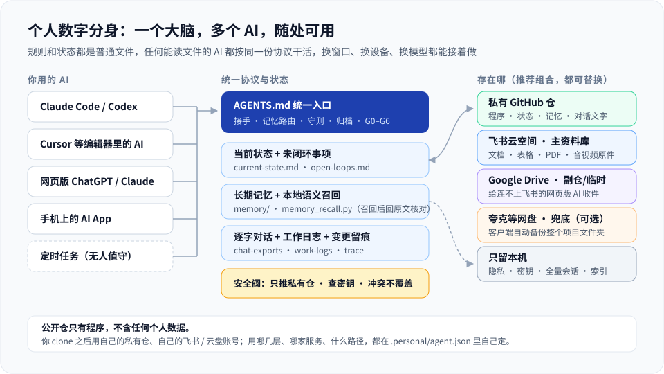

# 架构

个人数字分身把“连续性”当成数据设计问题来解决：AI 的工作上下文不放在聊天窗口里，而是放在你掌控的文件里。

## 三个平面

- **控制平面（程序）**：`AGENTS.md`、`config/`、`workflows/`、`templates/`、`tools/`。规则、流程、模板和工具，可以 fork、可以随上游更新，不带任何个人数据。
- **数据平面（你的数据）**：`.personal/`。当前状态、记忆、项目、知识、逐字对话、工作日志、任务卡、留痕、原件资料。公开模板里整个被 Git 忽略；私有仓模式下文字状态进你的私有仓，原件走云盘。
- **设备平面（本机）**：`.device/`（本机路径、设备名、凭据）和 `.local/`（索引、缓存、日志、全量会话备份）。每台机器各自生成，不同步。

## 记忆分层与路由

| 层 | 文件 | 什么时候用 |
|---|---|---|
| 当前会话 | 对话上下文 | 刚聊过的，直接用 |
| 当前状态 | `.personal/current-state.md` | 全局唯一的“现在在做什么、停在哪” |
| 未闭环事项 | `.personal/memory/open-loops.md` | 跨窗口、跨设备、跨 AI 要接着做的事 |
| 长期记忆 | `.personal/memory/*.md` | 偏好、规矩、稳定的决定（追加、写日期、不覆盖） |
| 历史原文 | `.personal/logs/chat-exports/`、项目目录、知识库 | 要精确日期、原话、数字、决策依据时 |
| 语义索引 | `.local/memory_index.db` | 帮你在原文里找线索；只是缓存，召回后必须回原文核对 |

Router 按这次需要的信息类型决定查哪层，不是固定流水线；状态和证据都要时两层一起查。

## 一份当前状态

`.personal/current-state.md` 是唯一的全局当前状态。按日期的交接放 `.personal/handoff/`，项目自己的状态放各项目目录。这样不会出现几份“最新状态”悄悄分叉。

## 归档流水线

1. `chat_archive.py` 从本机 AI 的会话文件（Claude Code、Codex 等）逐字导出 Markdown，按会话号和修改时间幂等，只补新的和变过的。
2. `memory_index.py` 把 `.personal/` 里的文字切块、向量化，存进本地 SQLite。
3. `chat_archive.py index` 按实际文件生成总索引 `00_index.md`。
4. `refresh.py` 把上面几步串成一条命令，另外列出超过 30 天没核实的记忆段落；定时任务每天跑两次。

## 安全阀

- `pre-push` 钩子：只许推到 `.personal/agent.json` 里登记的 `private_remote`。
- `pre-commit` 钩子：`upload_check.py --staged` 查密钥、身份证号、隐私目录、原件目录、超大文件和嵌套仓库；`workflow_gate.py` 查暂存边界，开启 `require_task_card` 后还核对任务卡。
- `sync.py` / `auto_sync.py`：三方合并、不覆盖、不硬推、推送后回读核对。

## 设计取舍

- **为什么状态放 Git 而不是云盘**：几个 AI 和几台设备都在改，Git 能合并、能回退、提交前能查密钥；云盘两边都改时只能二选一或者两份都留。
- **为什么原件不放 Git**：体积大、二进制、改动少、主要是查阅，Git 历史一旦进去就很难清掉。
- **为什么语义索引只留本机**：数据库里有原文片段，而且随时能从原文重建。
