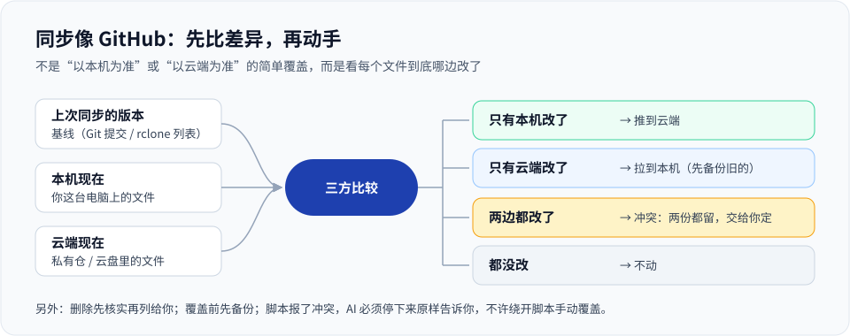

# 同步与差异：像 GitHub 一样，不是简单覆盖

很多“同步”其实是覆盖：以本机为准把云端冲掉，或者以云端为准把本机冲掉。几台设备、几个 AI 一起改同一批文件时，这样迟早丢东西。这里的规矩是先比差异、再动手。



## 五条规矩

1. **先拉后推**：先把云端在上次同步之后改过、新加、改了名的跟到本机，再把本机新的推上去。
2. **三方比较**：每个文件拿“上次同步时的版本”（基线）分别和本机、云端比。
   - 只一边改了 → 同步到另一边；
   - 两边都没改 → 不动；
   - **两边都改了 → 冲突，哪边都不覆盖，两份都留，列给你定**。
3. **删除和改名不靠猜**：云端列表里找不到，不等于删了；核实删了的，列给你定，不自动删本机。
4. **覆盖之前先备份**被替换的那一份。
5. **脚本报了冲突，AI 必须停下来原样告诉你**，不许绕开脚本手动覆盖，也不许把“脚本跑完了”说成“没有冲突”。

## GitHub 一侧：`tools/sync.py`

```bash
python tools/sync.py pull
python tools/sync.py push --message "说明" 文件或目录…
python tools/sync.py push --task-card .personal/logs/task-cards/2026-01-01_示例.md --message "说明" 文件…
```

- 基线就是上一次提交。本机和云端都改过的文件用 `git merge-file` 三方合并；合不上的保留本机版本，列为分叉，交给你处理。
- 只暂存你列出的文件，不会把工作区里别的东西顺手带上去。
- 推送前云端刚好有新提交，就撤回本次提交、保留改动，提示你重跑。
- 推送后回读本机和远端的提交号，一致才算成功。
- 输出 `[停止]` 时照提示处理，不要绕开脚本强推。

## 飞书一侧：`tools/feishu_sync.py`（推荐的主资料库）

- 基线是 `.personal/feishu-map.json`：上次同步时每个文件的哈希、云端 token 和云端修改时间。它随私有仓同步，所以另一台设备也知道上次同步到哪。
- 只本机改了就上传新版本；只云端改了就下载（先备份本机旧版）；两边都改了算冲突，云端那版另存一份，哪边都不覆盖，命令返回非 0。
- 云端列表里找不到的，先按 token 核实；真删了的列给你定，不重传、不删本机。本机删了的也只列出，**从不删除云端文件**，也从不改分享权限。
- 第一次往某个账号写入前先 `plan`，看清“当前登录的是谁、存到哪个文件夹、要做哪些事”，确认后带计划编号 `sync --approve` 执行。

```bash
python tools/feishu_sync.py whoami
python tools/feishu_sync.py plan
python tools/feishu_sync.py sync --approve <计划编号>
python tools/feishu_sync.py pull      # 只把云端的新增和更新取回本机
python tools/feishu_sync.py verify    # 只读核对（会下载云端每个文件，库大时很慢）
python tools/feishu_sync.py resolve <路径>   # 处理完一个冲突或“云端已删”后，告诉登记表“以本机现在这份为准”，下次 plan 会重新给出上传，仍需确认
```

- 计划编号 24 小时内有效、只能用一次，换了账号、文件夹或本机目录就作废；执行前会重新比较，出计划之后又变了的文件会跳过并列出。
- 每台设备在 `.local/feishu/state.json` 记着“我上次同步到哪一版”。有了它，第二台设备手里的旧文件不会被误当成“本机改过”，把云端的新版覆盖掉。
- 定时同步（`sync --scheduled`）只有在当前飞书账号和文件夹与上次确认过的一致时才写入，换了账号或文件夹必须重新 `plan` + 确认。`.personal/feishu-map.json` 在默认的自动同步路径里，所以登记表的变化会随私有仓到达其他设备。

## 其他云盘：`tools/cloud_sync.py`（rclone bisync，副仓或替代主资料库）

rclone 的 `bisync` 会记住上一次两边的文件列表，作为基线做三方比较。`cloud_sync.py` 在它外面固定了几条安全参数：

- 冲突不自动选边，两份都留（输家文件名加 `conflict` 后缀和编号）；
- 一次删除超过 `cloud.max_delete_percent`（默认 10%）就停下；
- 本机一侧被替换或删除的文件，先挪进 `.local/cloud_backups/<时间>/`；
- `.personal/private/` 和 `local_only` 里的路径永远不上传；
- 出错可恢复（`--resilient --recover`）。

**和 Git、飞书一侧不一样的地方，用之前要知道：**

- bisync 会把删除双向传播：你在本机删了文件，下一次同步云端那份也会被删（反过来也一样）。靠删除阈值兜底，不是“列出来等你定”。
- 云盘一侧被覆盖或删除的旧版本**没有**备份，需要的话打开云盘自己的版本历史或回收站。
- `init --yes` 建立基线时，两边同名但内容不同的文件会以**本机版本为准**替换云端那份；不想要这样，先手动处理这些文件再 init。

```bash
python tools/cloud_sync.py init          # 第一次：先预览，不改任何东西
python tools/cloud_sync.py init --yes    # 确认后建立基线（见下面的提醒）
python tools/cloud_sync.py plan          # 之后每次：预演，看会发生什么
python tools/cloud_sync.py run           # 正式同步
```

需要 rclone 1.66 或更新版本，云盘连接用 `rclone config` 自己配好（凭据保存在 rclone 自己的配置里，不进本仓库）。

## 同步不是备份

同步会把误删和损坏也同步过去。另外留一份能恢复的备份：另一块硬盘、带版本历史的网盘，或者本机加密后的离线归档。
